# Shipping ERP: manuale d'uso

Versione 0.1.0

Powered by Francesco Foti · ITS Team Innovazione

## A chi serve

Serve agli studenti che imparano a gestire un magazzino: carichi, scarichi, ordini, fatture e inventario.
Serve ai docenti che preparano la lezione, assegnano i ruoli e controllano il lavoro della classe.
I dati sono di esercitazione: si può sbagliare, correggere e ricominciare.

## Come si entra

Non serve un indirizzo email. Ti registri con un **nome utente** e una **password**. Poi entri quando vuoi con gli stessi dati. I passaggi con le schermate sono nel capitolo A.

Dopo l'accesso scegli dove lavorare:

- **Il mio magazzino**: è solo tuo. Serve per fare pratica da solo, senza nessun altro.
- **Una classe**: è il magazzino condiviso con i compagni. Per entrare serve il **codice di 6 caratteri** che ti dà il docente. Lo scrivi nella carta "Entra con codice".

Chiunque può registrarsi. Finché non entri in una classe vedi solo il tuo magazzino personale.

Il pannello "Entra come", che vedi in alcune schermate di prova, serve solo a provare l'app con utenti già pronti. Con il tuo account usi nome utente e password.

---

## A. Accesso e primo ingresso

**Obiettivo:** registrarti, entrare e arrivare al tuo magazzino o a quello della classe.

### Passaggi

1. Apri l'indirizzo dell'app. Compare la pagina Accedi.

   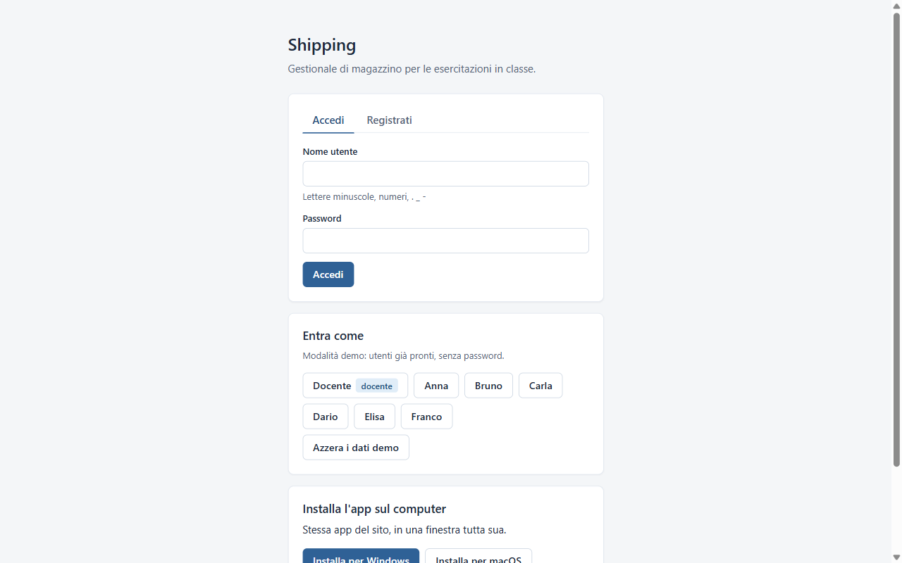

2. Se non hai ancora un account, apri la scheda Registrati.
3. Scrivi il tuo nome (es. Marco Rossi).
4. Scegli un nome utente: da 3 a 20 caratteri, solo lettere minuscole, numeri, punto e trattino (es. marco.rossi).
5. Scegli una password di almeno 6 caratteri. Premi Crea account.

   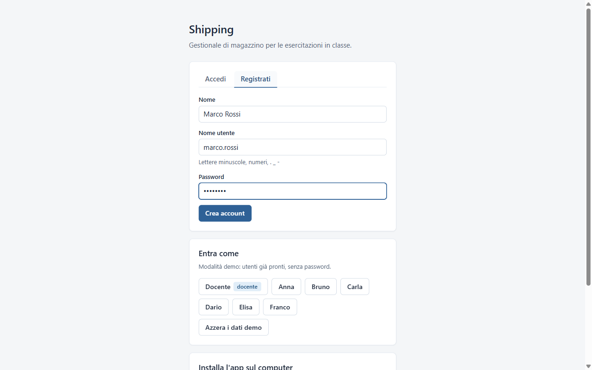

6. Dopo la registrazione si apre "Scegli il magazzino". Premi Entra accanto a "Il mio magazzino" per iniziare da solo.

   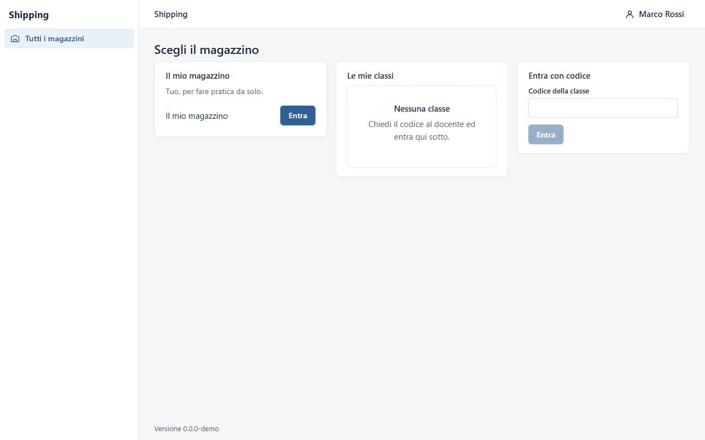

7. Se hai già un account, apri la scheda Accedi, scrivi nome utente e password e premi Accedi.

   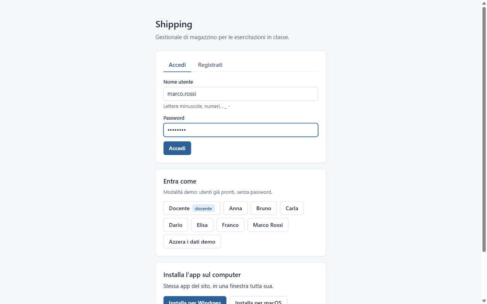

8. Per entrare in una classe, nella carta "Entra con codice" scrivi il codice di 6 caratteri del docente. Le lettere diventano maiuscole da sole. Premi Entra.

   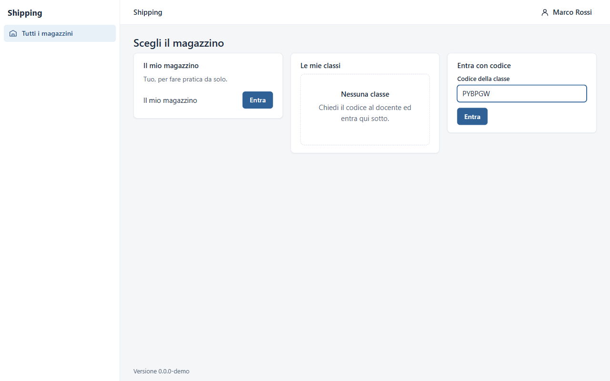

9. Dopo Entra si apre il magazzino della classe. In alto vedi il nome della classe.

   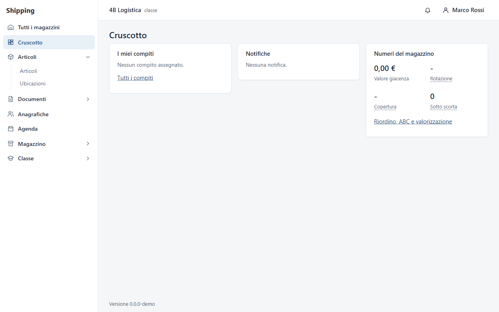

10. Sul telefono le carte si mettono una sotto l'altra. Il menu si apre con il pulsante a tre righe in alto a sinistra.

    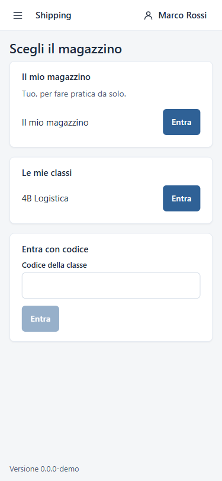

11. Premi il pulsante a tre righe per aprire il menu a cassetto. Scegli una voce: il menu si chiude da solo. Esc o il pulsante di chiusura lo chiudono senza scegliere.

    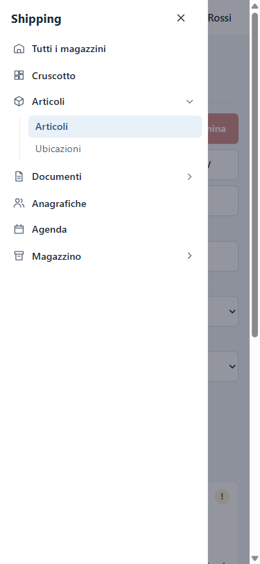

### Cosa succede

Entrando in una classe sei collegato al suo magazzino condiviso. Se il docente non ti ha ancora dato un ruolo aziendale sei "jolly" e puoi fare tutte le azioni. Nel menu trovi la sezione Classe, con Compiti e Attività.

### Errori comuni

- **Nome utente o password sbagliati**: il programma non ti fa entrare. Controlla maiuscole e lettere. Non esiste un recupero password dal sito: avvisa il docente.
- **Codice non valido**: il codice deve avere 6 caratteri. Se il docente lo ha disattivato o rigenerato, il vecchio codice non funziona più. Chiedi quello nuovo.
- **Nome utente già preso**: scegline un altro.

---

## B. Articoli, carichi e scarichi

**Obiettivo:** creare un articolo, registrare l'arrivo di merce (carico) e la sua uscita (scarico).

### Passaggi

1. Prima di creare un articolo con un fornitore, crealo in Anagrafiche. Menu Anagrafiche, poi Nuovo fornitore. Scrivi codice e ragione sociale (obbligatoria), indirizzo, partita IVA e altri dati. Indica i Giorni di consegna: servono al calcolo del riordino. Premi Salva.

   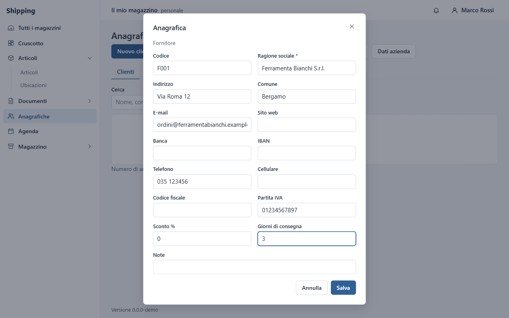

2. Menu Articoli, poi Nuovo articolo. Nella scheda Dati scrivi la Matricola (codice unico, obbligatorio) e la Descrizione (obbligatoria). Scegli l'unità di misura (PZ., KG., LT. e altre) e la categoria. Passa alla scheda Prezzi.

   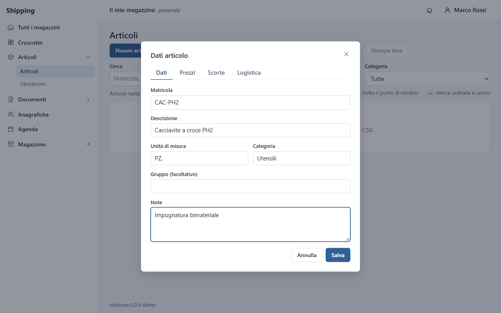

3. Nella scheda Prezzi scrivi il prezzo di acquisto in euro senza IVA (es. 4,50) e l'IVA (es. 22%). Scrivi il ricarico in percentuale (es. 40%). Il prezzo di listino e il prezzo di vendita si calcolano da soli.

   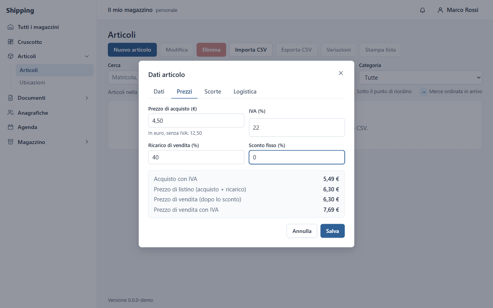

4. Nella scheda Scorte scrivi la giacenza iniziale (es. 60). Si imposta solo alla creazione: poi cambia con i movimenti. Compila scorta minima, scorta di sicurezza, lead time e domanda giornaliera. Il punto di riordino puoi lasciarlo vuoto: lo propone il programma.

   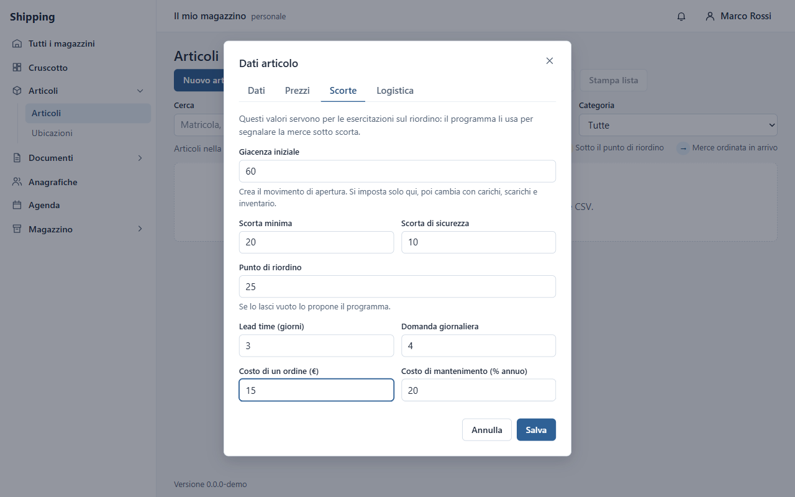

5. Nella scheda Logistica scegli l'ubicazione (il posto dove tieni la merce) e il fornitore abituale. Se la merce ha i lotti, spunta Gestione lotti. Premi Salva.

   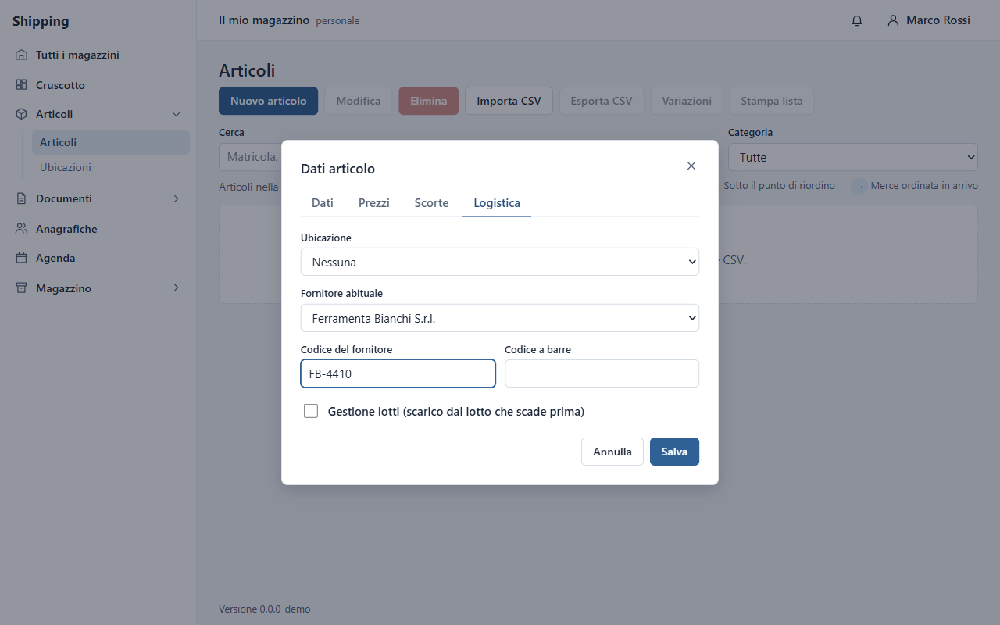

6. Menu Articoli. Leggi la colonna Stato: il segno verde è disponibile, il giallo ! è sotto il punto di riordino, il blu → è merce già ordinata in arrivo. Clicca una riga per vedere i movimenti, i lotti e le giacenze di quell'articolo.

   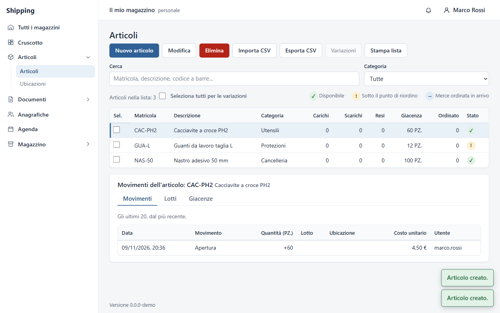

7. Per registrare un arrivo: menu Documenti, poi Carichi, poi "Nuovo: carico". Scegli il Fornitore scrivendo nome o codice e selezionandolo dalla lista.
8. Nella riga scegli l'Articolo: descrizione, prezzo e IVA si compilano da soli. Scrivi la Quantità (es. 50 guanti da lavoro taglia L).
9. Controlla i totali e premi Conferma. La merce entra in magazzino. Con "Salva bozza" il magazzino non cambia.

   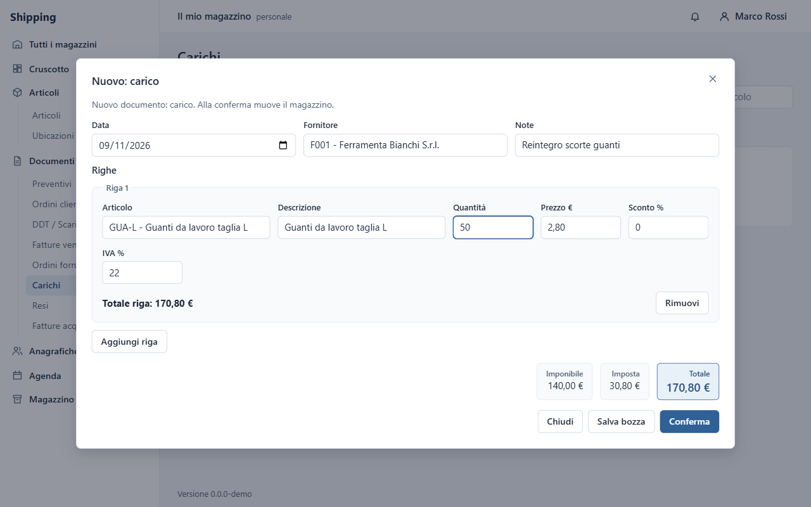

10. Dopo Conferma il carico riceve il numero e passa a "Confermato". La giacenza dei guanti sale di 50 pezzi. Clicca il documento in elenco per rivederne il dettaglio.

    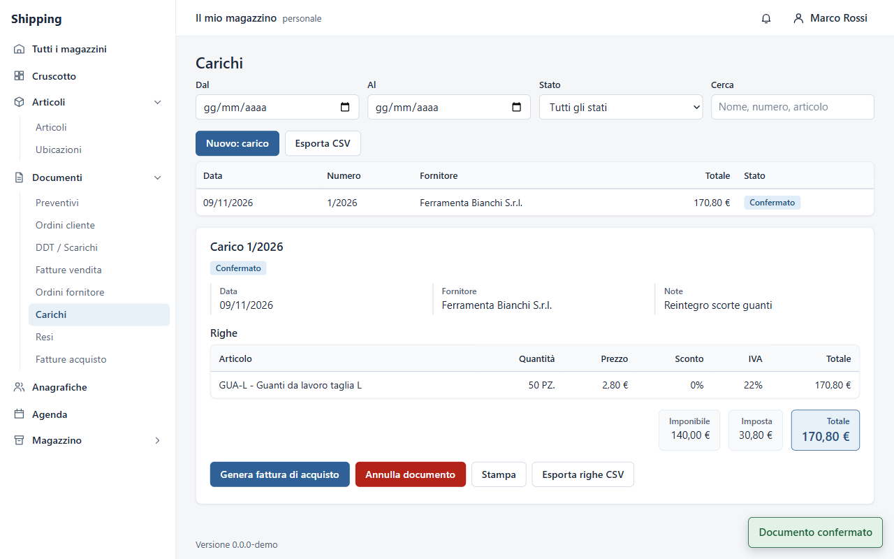

11. Per registrare un'uscita verso un cliente: menu Documenti, poi DDT / Scarichi, poi "Nuovo: scarico". Scegli il Cliente dalla lista.
12. Scegli l'articolo e scrivi la quantità da consegnare (es. 10 cacciaviti per Edilizia Colombo). Premi Conferma: la merce esce dal magazzino.

    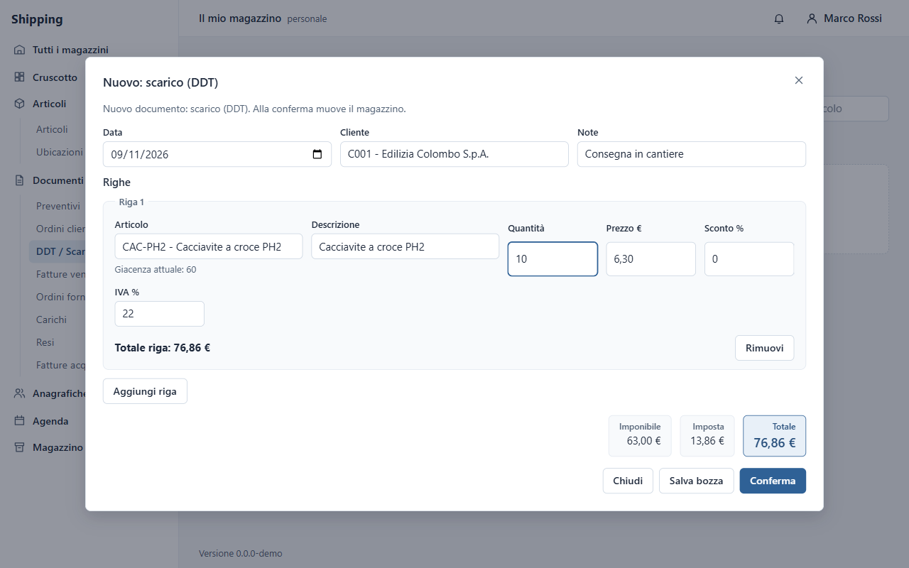

13. Dopo Conferma lo scarico è numerato. La giacenza dei Cacciaviti scende da 60 a 50. Da qui puoi generare la fattura di vendita (capitolo C).

    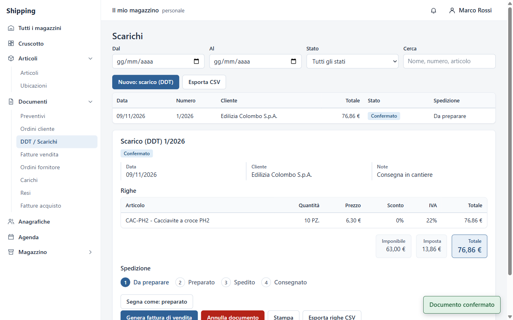

14. Se la quantità è più alta della giacenza, il programma non scarica. Mostra un messaggio rosso "Giacenza insufficiente" con i pezzi disponibili e quelli richiesti. La bozza resta salvata. Riduci la quantità, oppure riordina con un ordine fornitore o dai suggerimenti di riordino (capitolo G).

    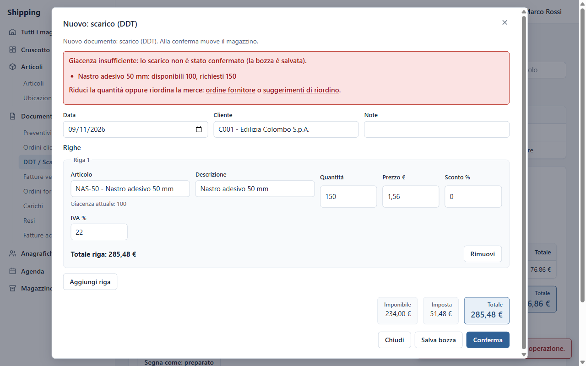

15. Per capire un campo, ferma il mouse per un secondo e mezzo sull'etichetta, per esempio "Punto di riordino". Compare un riquadro con la spiegazione. Vale anche per Lead time, Scorta di sicurezza, Ricarico e altre voci. Sul telefono compare un "?" da toccare.

    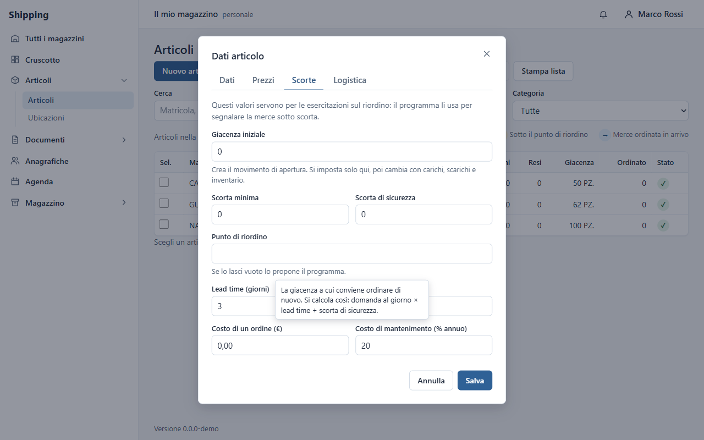

16. Sul telefono ogni articolo è una scheda: matricola, descrizione, giacenza e stato. Il pallino giallo a destra vuol dire sotto il punto di riordino. I pulsanti Nuovo articolo, Modifica ed Elimina restano in alto.

    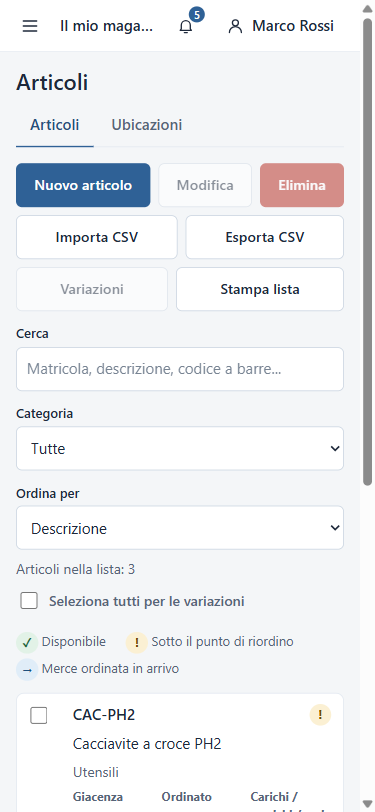

17. Sul telefono i dialoghi occupano tutto lo schermo. Scorri in basso per righe, totali e pulsanti Conferma e Salva bozza.

    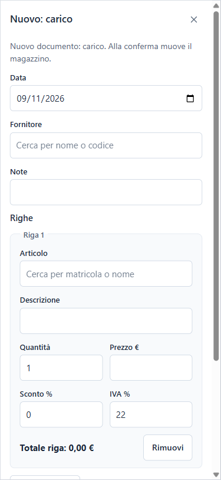

### Cosa succede

Un carico aumenta la giacenza. Uno scarico la riduce. Solo i documenti confermati muovono il magazzino: le bozze no. Ogni documento confermato riceve un numero.

### Errori comuni

- **Giacenza insufficiente**: lo scarico non viene confermato. Riduci la quantità o riordina la merce prima di scaricarla.
- **Matricola o descrizione mancanti**: sono obbligatorie. Il programma non salva finché non le scrivi.
- **Fornitore o cliente non trovato**: vanno creati prima in Anagrafiche.
- **Articolo con movimenti**: un articolo si può eliminare solo se non ha ancora movimenti.

---

## C. Preventivi, ordini cliente, DDT e fatture di vendita

**Obiettivo:** seguire una vendita dal preventivo alla fattura pagata, passando per ordine e consegna.

### Passaggi

1. Menu Documenti, poi Preventivi, poi "Nuovo: preventivo". Scegli il cliente e aggiungi le righe con "Aggiungi riga".

   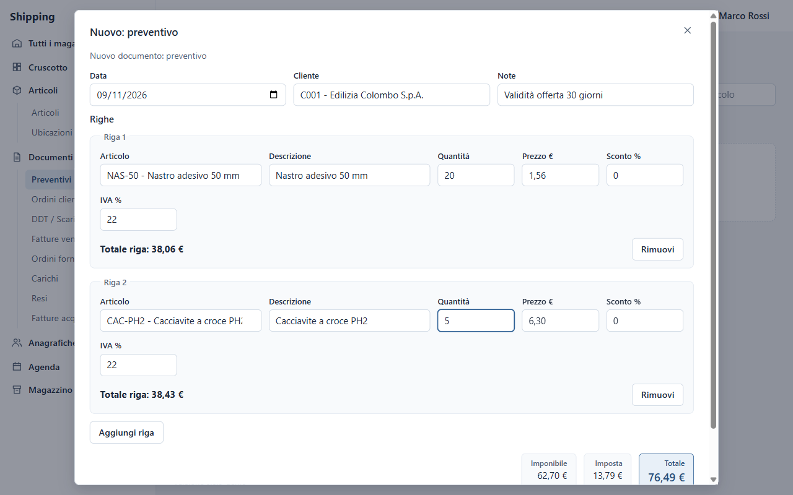

2. Un preventivo non muove il magazzino. Premi Conferma per numerarlo, oppure Salva bozza per finirlo dopo.
3. Il preventivo confermato mostra righe e totali. Per il passo successivo premi "Genera ordine cliente": le righe vengono copiate.

   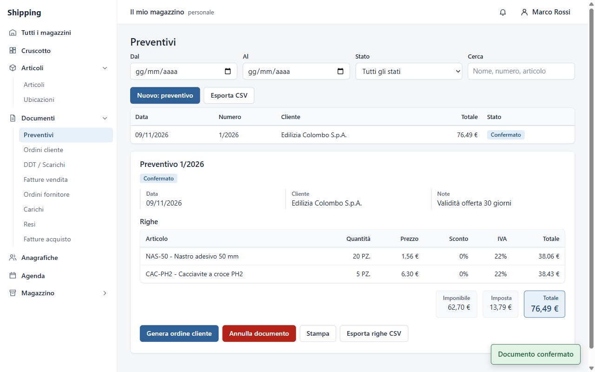

4. L'ordine cliente confermato mostra la sezione Spedizione a quattro passi e i Documenti collegati. L'origine è il preventivo, ora "Evaso". Per preparare la consegna premi "Genera scarico (DDT)".

   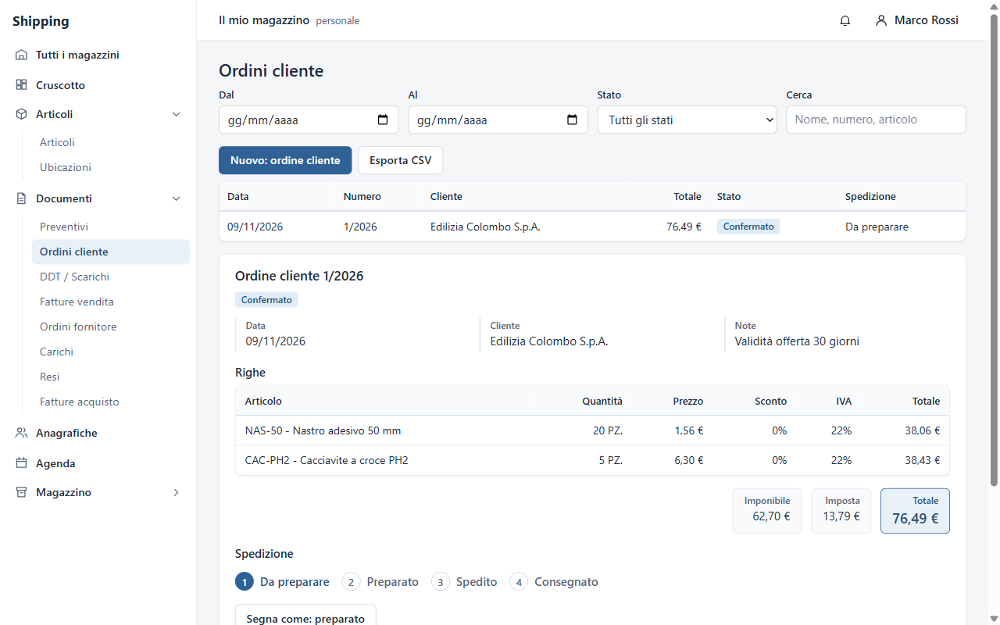

5. Il DDT confermato parte dallo stato "Da preparare". Premi "Segna come: preparato", poi "spedito", poi "consegnato". Lo stato va solo in avanti: non si torna indietro.

   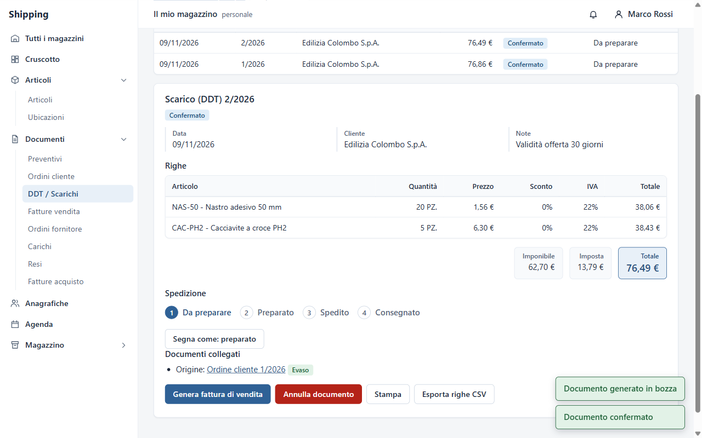

6. Dopo "preparato" e "spedito" i primi passi del percorso sono completati. Premi "Segna come: consegnato" a consegna avvenuta.

   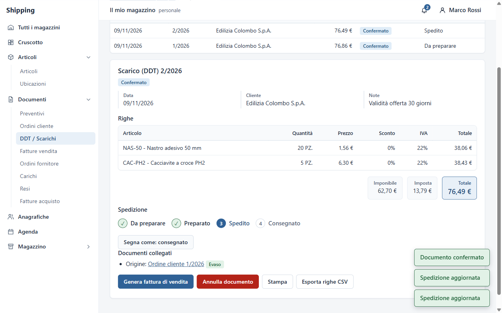

7. Premi "Genera fattura di vendita": la fattura si apre con le righe del DDT. Compila Banca, IBAN e Condizioni di pagamento.
8. Se serve, scrivi in ogni riga la percentuale INPS (es. 4) e la Ritenuta d'acconto (es. 20). Il totale da pagare si aggiorna da solo. Premi Conferma.

   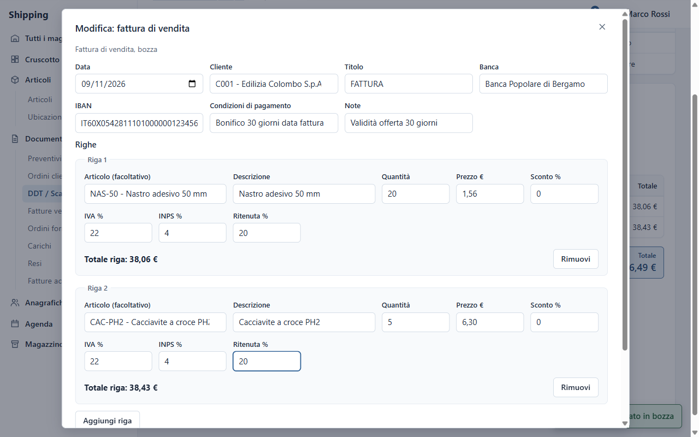

9. Scorri in fondo al dialogo. Leggi imponibile, INPS, IVA, ritenuta e totale da incassare. Premi Conferma per numerare la fattura.

   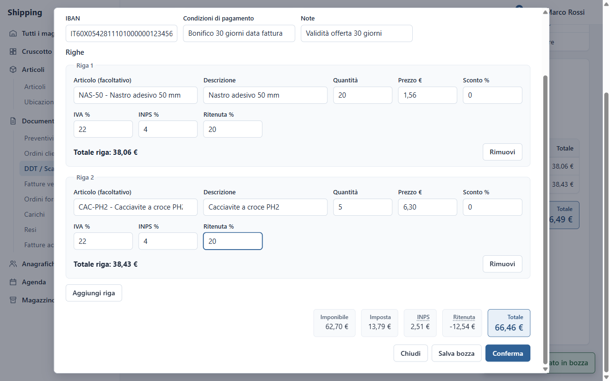

10. La fattura confermata compare come "Da pagare". Quando il cliente paga premi "Segna pagato".

    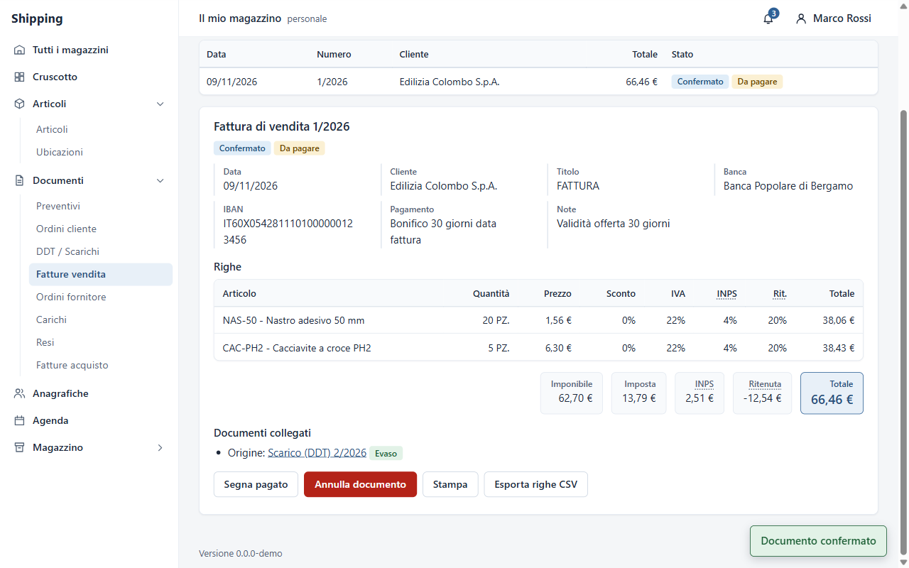

11. Per ripercorrere la catena apri un documento dall'elenco. In "Documenti collegati" vedi l'origine e i documenti derivati. Clicca un nome per saltare a quel documento.

    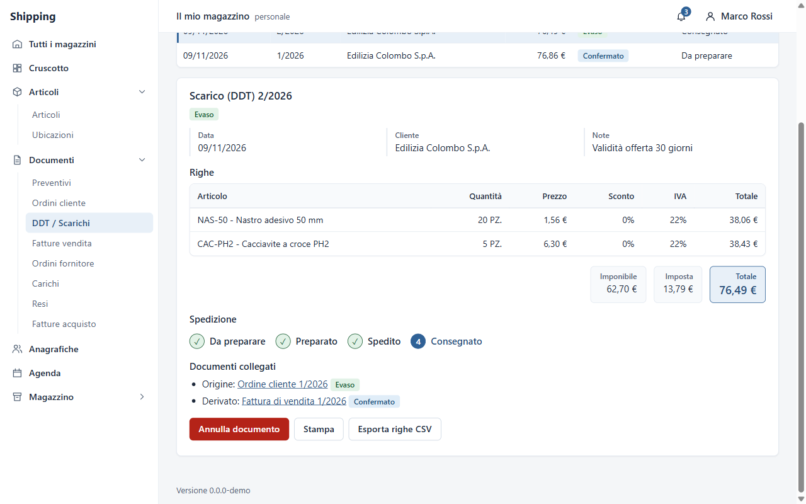

### Cosa succede

La catena è: preventivo, ordine cliente, DDT (scarico), fattura. Ogni passo copia le righe del precedente. Il DDT è quello che fa uscire la merce dal magazzino.

### Errori comuni

- **Non si può tornare indietro nella spedizione**: lo stato va avanti: da preparare a preparato, a spedito, a consegnato.
- **Non posso cancellare un documento confermato**: si può eliminare solo una bozza. Un documento confermato si annulla: l'annullo storna i movimenti e il documento resta in archivio.
- **Permesso negato**: il tuo ruolo aziendale non può fare quell'azione. Per esempio, solo amministrazione fa le fatture. Chiedi al docente di cambiare il ruolo.
- **Giacenza insufficiente sul DDT**: la merce non basta. Vedi il capitolo B.

---

## D. Ordini ai fornitori e merce in arrivo

**Obiettivo:** ordinare merce a un fornitore e ricevere la merce con l'evasione dell'ordine.

### Passaggi

1. Menu Documenti, poi Ordini fornitore, poi "Nuovo: ordine fornitore". Scegli il fornitore e le righe. Il prezzo proposto è quello di acquisto.

   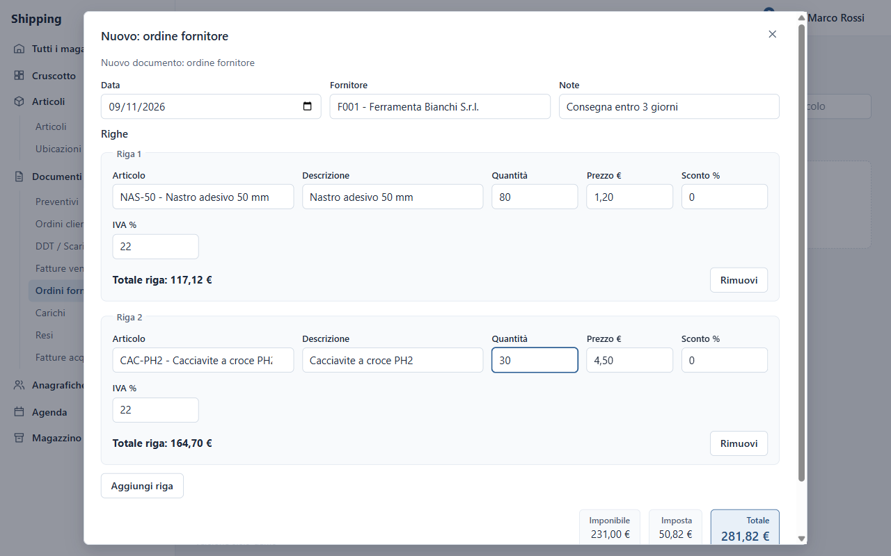

2. Premi Conferma. L'ordine non muove il magazzino, ma segnala "merce in arrivo".
3. Menu Articoli. La colonna Ordinato mostra le quantità attese (es. 80 nastri e 30 cacciaviti). Il segno blu → indica merce già ordinata.

   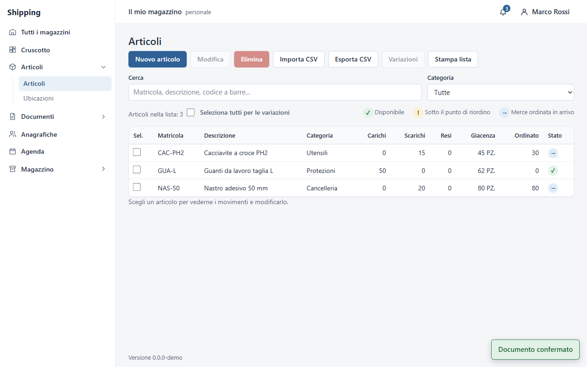

4. Quando la merce arriva, apri l'ordine e premi "Evadi ordine". Il programma crea e conferma il carico: la merce entra in magazzino.
5. L'ordine passa a "Evaso" e il carico risulta collegato all'ordine.

   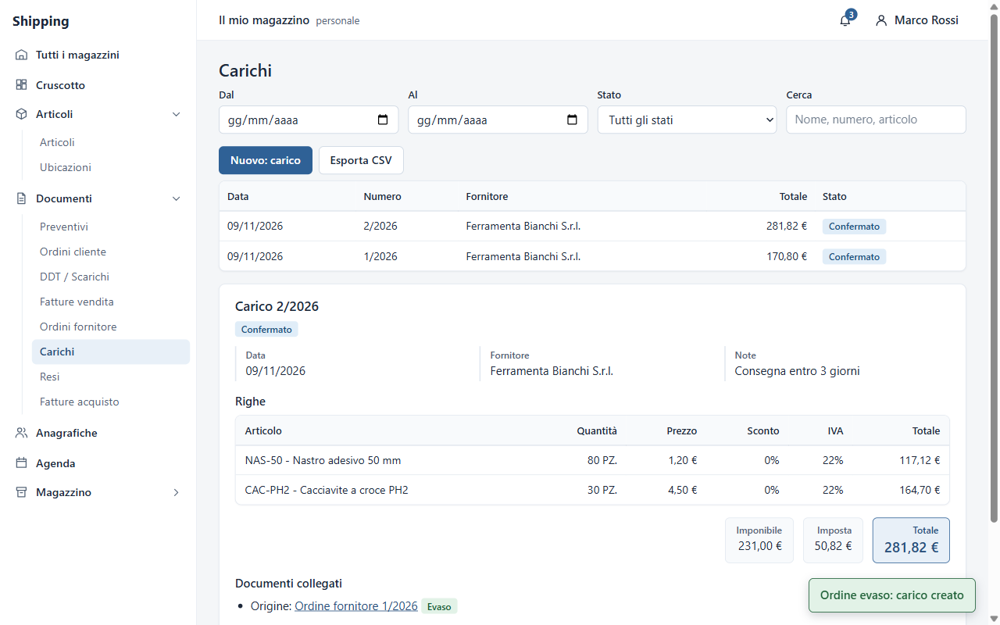

6. Quando ricevi la fattura del fornitore, generala dal carico. Quando la paghi premi "Segna pagato".

   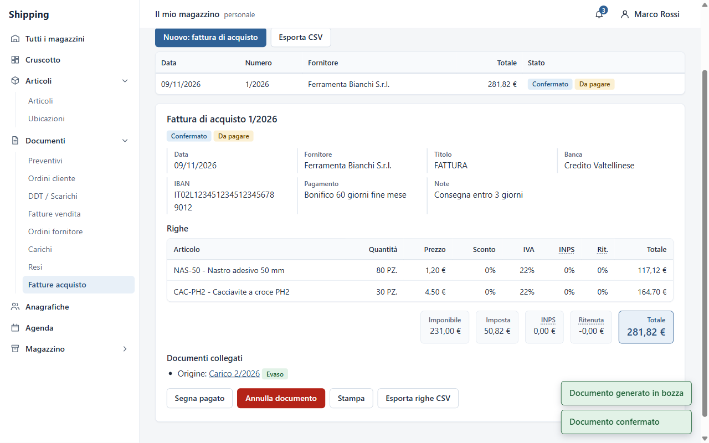

### Cosa succede

Il ciclo completo è: ordine fornitore, carico, fattura di acquisto. Il carico entra in magazzino solo quando evadi l'ordine, non quando lo confermi.

### Errori comuni

- **La merce non arriva in magazzino**: l'ordine resta confermato. Finché non lo evadi, la giacenza non cambia.
- **Permesso negato su "Evadi ordine"**: il ruolo acquisti o magazziniere può evadere; gli altri ruoli no.

---

## E. Anagrafiche, dati azienda e agenda

**Obiettivo:** tenere in ordine clienti, dati dell'azienda e appuntamenti o scadenze.

### Passaggi

1. Menu Anagrafiche, poi Nuovo cliente. Scrivi la ragione sociale (obbligatoria) e gli altri dati. Lo Sconto % del cliente può essere proposto nei documenti. Premi Salva.

   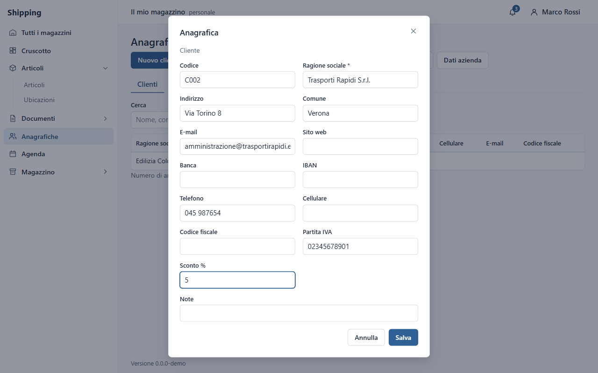

2. Menu Anagrafiche, poi Dati azienda. Scrivi i dati della tua azienda, con la ragione sociale obbligatoria. Questi dati finiscono nell'intestazione dei documenti stampati. Premi Salva.

   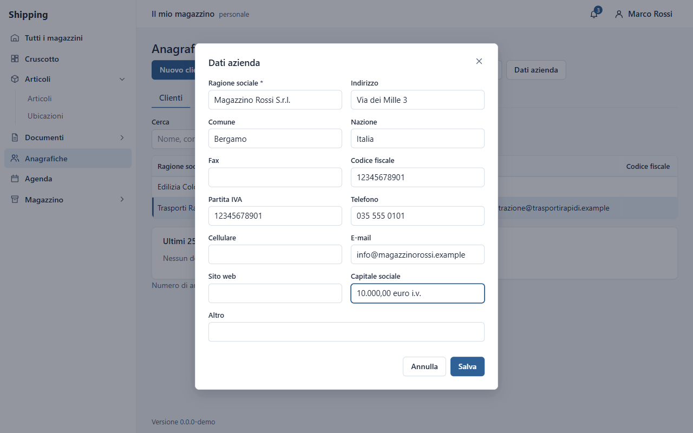

3. Apri Agenda e crea un nuovo impegno. Scrivi l'Oggetto (obbligatorio) e, se vuoi, la descrizione. Scegli Inizio e Fine.
4. Scegli il Tipo: Appuntamento o Scadenza. Se serve, collega un cliente o un fornitore. Premi Salva.

   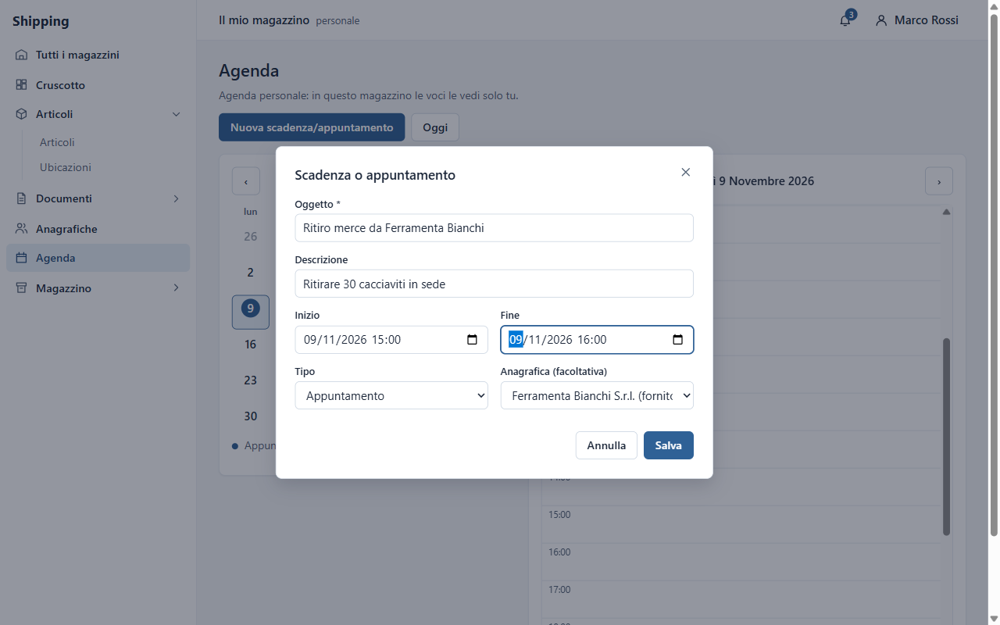

5. Dopo Salva l'impegno compare nel calendario del mese e nella vista del giorno. Usa le frecce per cambiare mese o giorno. "Oggi" ti riporta a oggi. Clicca un giorno del mese per vederlo a destra.

   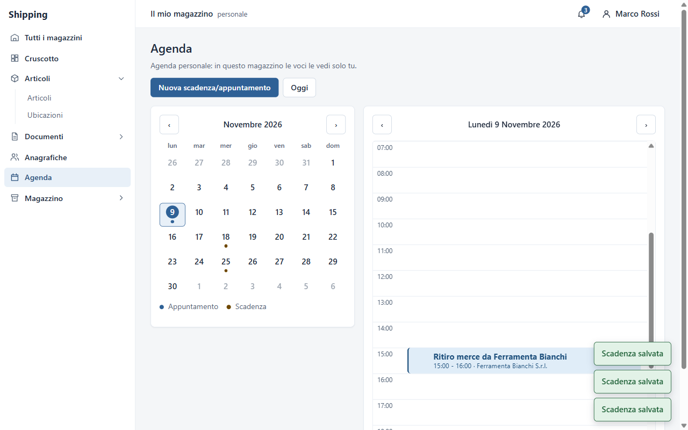

6. Sul telefono mese e giorno sono uno sotto l'altro. Scorri per vedere le fasce orarie.

   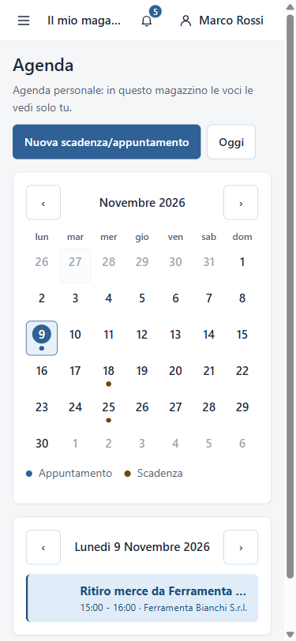

### Cosa succede

Le anagrafiche sono l'elenco di clienti e fornitori: li scegli nei documenti. I dati azienda compaiono nei documenti stampati. Gli impegni in agenda sono solo promemoria: non muovono il magazzino.

### Errori comuni

- **Ragione sociale mancante**: è obbligatoria. Il programma non salva.
- **Nessun cliente nell'elenco del documento**: crealo prima in Anagrafiche.
- **Non trovo l'appuntamento**: controlla il mese e il giorno che stai guardando. Premi "Oggi".

---

## F. Inventario

**Obiettivo:** confrontare la giacenza del programma con quella che trovi davvero a scaffale, e correggere le differenze.

### Passaggi

1. Apri Inventario e crea un nuovo inventario. Il programma crea una riga per ogni articolo con la quantità di Sistema.

   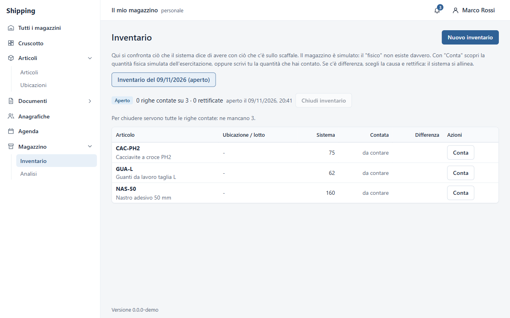

2. Premi "Conta" su una riga. Scrivi la quantità che trovi a scaffale (es. 73 cacciaviti, mentre il sistema dice 75). Premi "Registra quantità".

   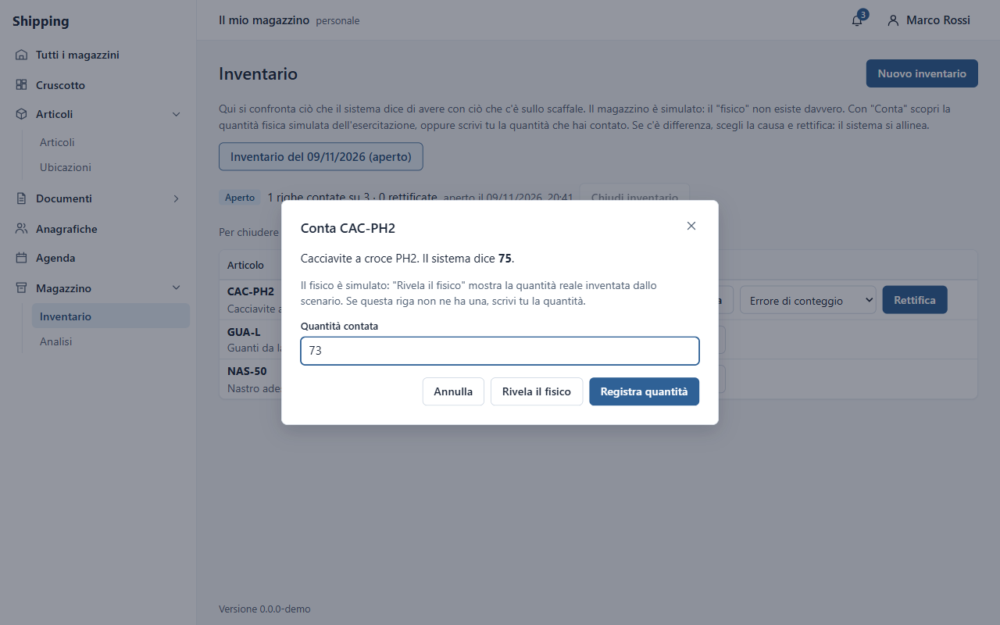

3. Dopo il conteggio la colonna Differenza mostra la differenza (es. -2). Scegli la causale dall'elenco: errore di conteggio, merce danneggiata, smarrita o errore di registrazione. Premi Rettifica: il sistema si allinea al fisico.

   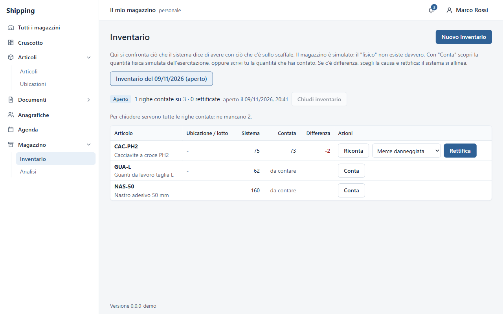

4. Per chiudere l'inventario devi aver contato tutte le righe. Premi "Chiudi inventario". Il riepilogo dice quante righe sono state rettificate.

   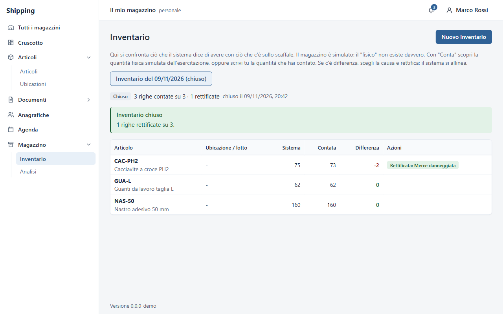

5. Il movimento di rettifica compare tra i movimenti dell'articolo, in Articoli.

6. In una classe con uno scenario il conteggio può essere simulato. Premi "Conta" sulla merce del compito. Premi "Rivela il fisico": il programma mostra la quantità reale preparata dal docente. Non devi contare davvero. In alternativa scrivi tu la quantità e premi "Registra quantità".

   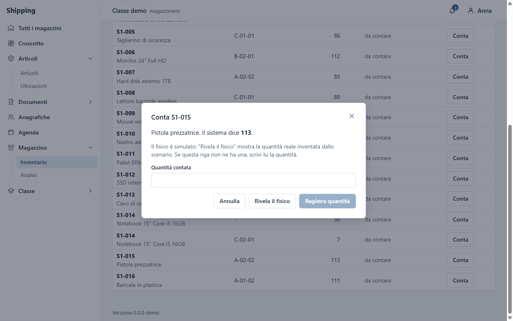

### Cosa succede

Il "fisico" è finto: nell'esercitazione la quantità reale è preparata dal docente. La rettifica scrive un movimento con la causale che hai scelto. Resta scritto, quindi chi guarda può capire il motivo.

### Errori comuni

- **Inventario non chiudibile**: c'è almeno una riga non ancora contata.
- **Causale non scelta**: scegli la causale prima di premere Rettifica.

---

## G. Analisi: riordino, KPI e valorizzazione

**Obiettivo:** capire cosa ordinare, quanto vale il magazzino e quanto gira la merce.

### Passaggi

1. Menu Magazzino, poi Analisi, poi la scheda Riordino. "Solo da riordinare" elenca gli articoli sotto il punto di riordino.

   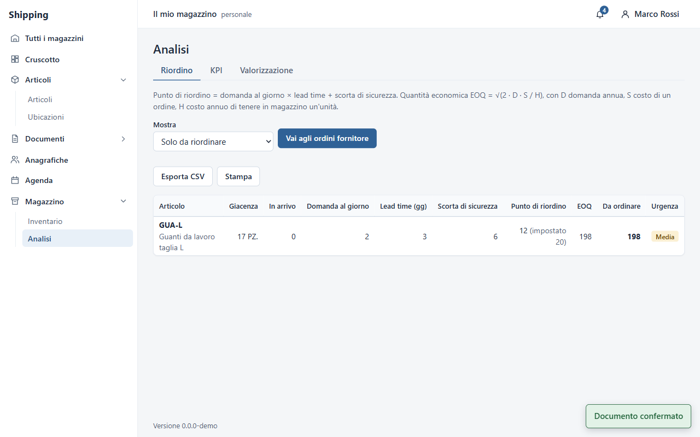

2. Leggi la colonna EOQ: è la quantità economica da ordinare per tenere basso il costo totale. Il costo totale è la somma tra il costo degli ordini e il costo di tenere la merce. Premi "Vai agli ordini fornitore" per fare l'ordine.
3. Apri la scheda KPI. Leggi il valore della giacenza, la rotazione (quanto spesso gira la merce), la copertura in giorni (per quanti giorni basta la scorta) e gli articoli sotto scorta. La classificazione ABC divide gli articoli per peso sui consumi.

   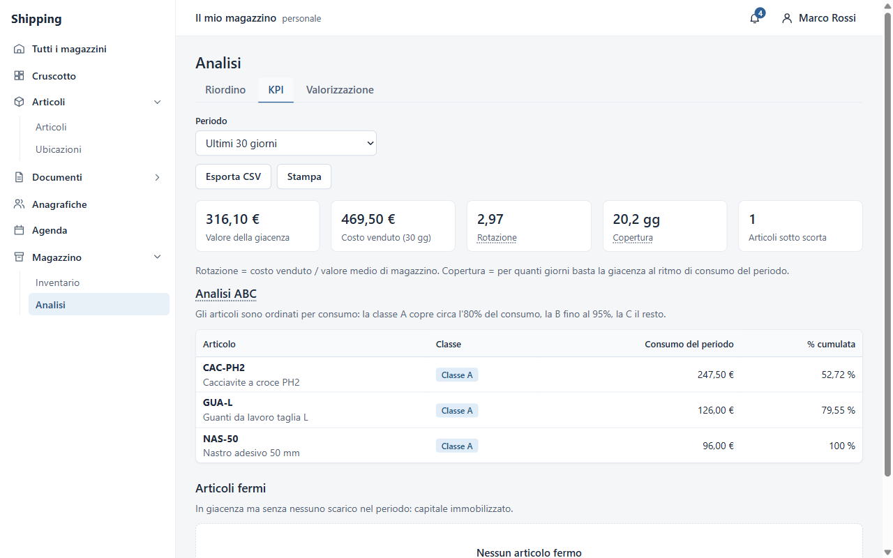

4. Apri la scheda Valorizzazione. Lo stesso magazzino è valutato con tre metodi: costo medio ponderato, FIFO e LIFO.
5. FIFO fa uscire per primo ciò che è entrato per primo, quindi in magazzino restano i prezzi recenti. LIFO fa uscire per primo l'ultimo entrato, quindi restano i prezzi vecchi. I valori sono diversi perché i carichi sono avvenuti a prezzi diversi (es. cacciaviti a 4,50 e poi a 5,20).

   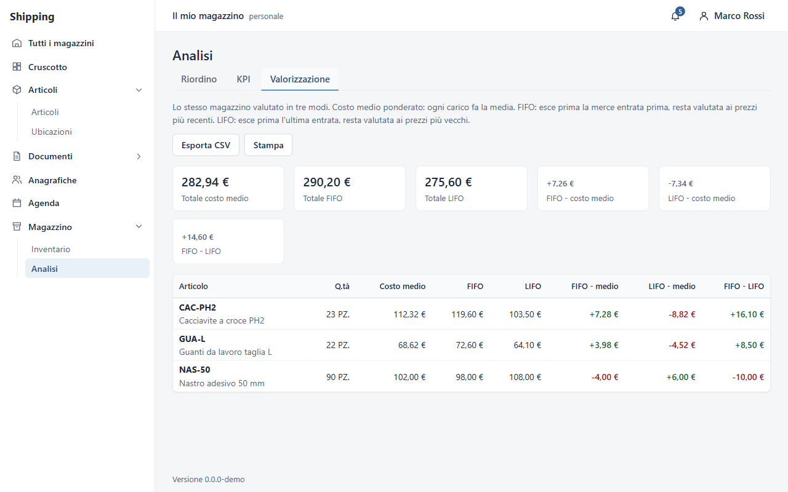

### Cosa succede

Il riordino non ordina nulla da solo: ti suggerisce cosa e quanto. Gli ordini li fai in Documenti. Le schede KPI e Valorizzazione sono solo letture: non cambiano il magazzino.

### Errori comuni

- **Nessun articolo in "Solo da riordinare"**: nessun articolo è sotto il punto di riordino. Il punto di riordino si calcola da domanda, lead time e scorta di sicurezza: controllali nella scheda Scorte.
- **Valori diversi tra metodi**: è normale. Dipende dai prezzi dei carichi, non da un errore.

---

## H. Area docente: classi, ruoli, scenari e controllo

**Obiettivo:** creare la classe, far entrare gli studenti, assegnare ruoli e scenari e seguire il lavoro della classe.

Questo capitolo riguarda il docente. Creare una classe è riservato ai docenti abilitati.

### Passaggi

1. Accedi come docente. Nelle carte trovi "Il mio magazzino", le tue classi e, solo per il docente, "Nuova classe" e "Area docente".

   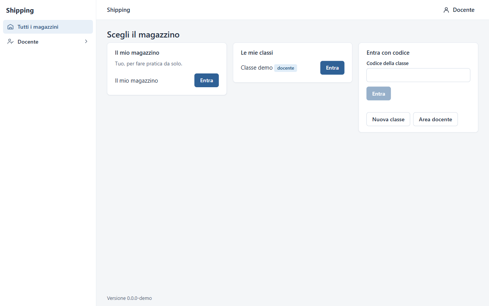

2. Premi "Nuova classe". Scrivi il nome della classe (es. 4B Logistica) e premi Crea. Si apre il magazzino della nuova classe.

   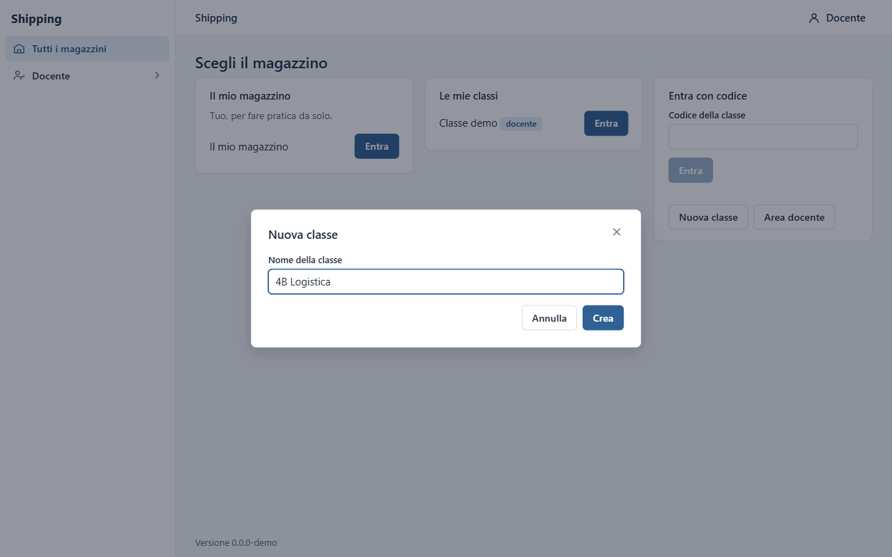

3. Menu Classe, poi Impostazioni classe. In "Codice di ingresso" trovi il codice a 6 caratteri da dare agli studenti. Puoi copiarlo, mostrarlo in grande per proiettarlo, stamparlo, disattivarlo o rigenerarlo.

   

4. Il codice funziona finché è attivo, e chiunque lo conosca può entrare. Quando la classe è al completo, premi "Disattiva codice". Premi "Rigenera" per cambiarlo: il codice vecchio non funziona più. Puoi riattivare il codice quando serve.
5. Nella tabella Membri vedi ogni studente con il suo ruolo. Per ognuno scegli il Ruolo aziendale. Il ruolo decide quali azioni può fare. Jolly vuol dire nessun ruolo: tutte le azioni.

   

6. Scorri in fondo a Impostazioni classe. "Giacenza negativa": scegli se uno scarico oltre la giacenza è bloccato (consigliato) o consentito.
7. Nella Zona pericolosa ci sono "Azzera dati" ed "Elimina classe". "Azzera dati" cancella i dati della classe e tiene membri e codice. "Elimina classe" cancella tutto.

   

8. Premi "Azzera dati". Il programma chiede di scrivere il nome esatto della classe. Il pulsante di conferma resta disattivato finché il nome non coincide. Se non sei sicuro premi Annulla.

   

9. Nell'area docente della classe premi "Crea scenario". Scrivi il nome e il Seed: con lo stesso seed esce sempre lo stesso scenario. Imposta il numero di articoli.
10. Attiva "Sottoscorta forzata" per far scattare la scorta bassa quando più studenti scaricano la stessa merce. Attiva "Con inventario" per creare una differenza tra sistema e fisico da scoprire. Premi Genera.

    

11. Dopo Genera lo scenario è in "Bozza": gli studenti non vedono ancora i compiti. Controlla la tabella: ogni studente ha compiti adatti al suo ruolo aziendale. I compiti "Bloccato" aspettano la merce e si sbloccano da soli. Con "Riassegna a" sposti un compito a un altro studente. Premi Attiva quando sei pronto.

    

12. Dall'Area docente apri la classe. Nella colonna Presenza vedi chi è online (la lista si aggiorna ogni 5 secondi). Le colonne Pagina e Ultima azione dicono cosa sta facendo ciascuno. La colonna Compiti dice quanti ne ha completati e se ha errori o compiti bloccati.

    

    Il contenuto dei magazzini personali degli studenti non è visibile. Vedi solo che lo studente lo sta usando.

13. Nella sezione Scenari premi "Compiti" sullo scenario attivo. La tabella mostra tutti i compiti di tutti gli studenti e il loro stato. Cerca le righe in Errore o Bloccato: sono gli studenti che hanno bisogno di aiuto.

    

14. A fine esercitazione premi "Controlla scenario". Il programma elenca le anomalie trovate, divise per tipo: giacenze negative, ordini non evasi, DDT senza fattura, fatture senza DDT, spedizioni ferme e compiti in errore. Usalo per commentare in classe cosa è rimasto in sospeso.

    

### Cosa succede

I dati della classe restano finché il docente non li azzera o li elimina. Non ci sono cancellazioni automatiche. Il docente vede chi è online e che cosa sta facendo, ma non il contenuto dei magazzini personali degli studenti.

### Errori comuni

- **Il pulsante Conferma di "Azzera dati" non si accende**: il nome scritto non coincide con quello della classe. Controlla maiuscole e spazi.
- **Lo studente dice che il codice non va**: il codice è disattivato o è stato rigenerato. Controlla in Impostazioni classe e dagli quello attivo.
- **Lo studente non vede i compiti**: lo scenario è ancora in Bozza. Premi Attiva.
- **Permesso negato**: il docente gestisce classi e scenari; lo studente con ruolo non può farlo.

---

## I. Esercitazione di gruppo: compiti, scorta condivisa e riordino

**Obiettivo:** seguire come studenti diversi lavorano sulla stessa merce, e come un compito si blocca, si sblocca e si completa.

Questo capitolo è dal punto di vista dello studente. Le schermate sono di Anna (magazziniere), Elisa (magazziniere), Carla (commerciale) e Bruno (acquisti).

### Passaggi

1. Accedi, entra nella classe e apri Classe, poi Compiti. Ogni scheda è un compito: leggi cosa registrare, quale merce e per quale cliente o fornitore. Premi "Apri il documento" per andare alla schermata giusta.

   

2. Dal compito premi "Apri il documento", poi "Nuovo: scarico (DDT)". Scegli il cliente, la merce e la quantità indicate dal compito. Premi Conferma: il programma controlla da solo se hai fatto bene il compito.

   

3. Un secondo studente scarica la stessa merce per un altro cliente. Nella riga "Giacenza attuale" vedi quanta merce resta dopo lo scarico del primo. Premi Conferma: la giacenza scende ancora.

   

4. Quando la giacenza scende sotto il punto di riordino, nella colonna Stato compare il segno giallo !. Il programma avvisa tutta la classe e assegna un compito di riordino a chi fa gli acquisti.

   

5. La campanella in alto mostra un numero rosso quando ci sono notifiche non lette. Premila per leggere l'avviso. La notifica è uguale per tutta la classe.

   

6. Entra come un altro studente, per esempio Carla. Nel Cruscotto, nel riquadro Notifiche, trovi lo stesso avviso. Il riquadro "I miei compiti" riassume i compiti personali.

   

7. Lo studente con ruolo Acquisti apre Classe, poi Compiti. In cima compare il compito di riordino per la merce sotto scorta. Leggi quanto serve e a quale fornitore ordinare.

   

8. Dal compito di riordino premi "Apri il documento", poi "Nuovo: ordine fornitore". Scegli il fornitore indicato. Scrivi una quantità almeno pari a quella richiesta (es. 30 invece di 17, per coprire anche lo scarico bloccato). Premi Conferma.

   

9. Torna in Classe, poi Compiti. Il compito di riordino resta "Da fare": aspetta che la merce arrivi. Si chiude da solo solo quando la merce è entrata e la giacenza supera il punto di riordino.

   

10. Uno scarico che non trova merce diventa "Bloccato", con il motivo "non c'è abbastanza merce in magazzino: serve un riordino". Non puoi farlo finché la merce non arriva.

    

11. Quando la merce arriva, il magazziniere apre Documenti, poi Ordini fornitore. Seleziona l'ordine confermato dagli acquisti e premi "Evadi ordine". Il carico entra in magazzino.

    

12. Torna in Classe, poi Compiti. Entro 5 secondi il compito bloccato torna "Da fare" e l'avviso sparisce. Ora puoi registrare lo scarico.

    

13. Se il compito è in "Errore", la scheda elenca cosa non va: quantità attesa e quantità trovata. Per correggere, apri il documento sbagliato e annullalo.

    

14. Apri il documento sbagliato in Documenti, poi DDT / Scarichi. Premi "Annulla documento" e leggi la conferma. Premi di nuovo "Annulla documento": i movimenti vengono stornati e la merce torna in magazzino.

    

15. Registra di nuovo lo scarico con i dati giusti e conferma. Il controllo si ripete da solo: il compito diventa "Completato" e il contatore dei completati sale.

    

### Cosa succede

Il compito di scarico ha bisogno di merce. Il magazzino è condiviso dalla classe, quindi uno studente può svuotare la scorta che serve a un altro. Il programma allora avvisa tutti, chiede un riordino e sblocca i compiti quando la merce arriva.

### Errori comuni

- **Compito bloccato**: manca merce. Non è un errore tuo: aspetta l'ordine e la sua evasione. Il compito si sblocca da solo.
- **Compito in errore**: hai registrato una quantità o un cliente diversi da quelli del compito. Annulla il documento e registralo di nuovo.
- **Giacenza insufficiente**: come nel capitolo B, riduci la quantità o chiedi un riordino.

### Nota sulla demo

Nella demo locale due studenti non possono agire nello stesso istante. Per questo gli scarichi di Anna ed Elisa sono stati fatti uno dopo l'altro, con lo stesso effetto: scorta bassa, notifica e compito di riordino. Sul database condiviso di una classe, due scarichi simultanei sulla stessa merce funzionano: il programma protegge la giacenza.

---

## Esercitazione di gruppo spiegata

Un'esercitazione con scorta condivisa segue questa sequenza. Le immagini sono quelle del capitolo I.

1. **Scorta bassa.** Più studenti scaricano la stessa merce. Quando la giacenza scende sotto il punto di riordino, compare il segno giallo.

   

2. **Notifica a tutti.** Il programma avvisa l'intera classe. Ogni studente la vede nella campanella e nel Cruscotto.

   

3. **Riordino.** Lo studente con ruolo Acquisti riceve un compito di riordino e fa l'ordine al fornitore.

   

4. **Evasione.** Quando la merce arriva, il magazziniere evade l'ordine. Il carico entra in magazzino.

   

5. **Sblocco.** I compiti bloccati tornano "Da fare" e si possono registrare.

   

Il compito di riordino resta "Da fare" dopo che hai fatto l'ordine. Si chiude solo quando la merce arriva ed evadi l'ordine. Il riordino è un'esercitazione con dati finti: serve a capire la sequenza, non a gestire un magazzino vero.

---

## Ruoli aziendali

Ogni studente della classe ha un ruolo aziendale, scelto dal docente. Il ruolo decide quali azioni puoi fare. Nel tuo magazzino personale sei sempre il proprietario e puoi fare tutto.

| Ruolo | Cosa può fare |
| --- | --- |
| Magazziniere | Carichi, scarichi, resi, trasferimenti, inventario, evasione degli ordini, spedizioni, lotti e ubicazioni, scadenze |
| Acquisti | Ordini ai fornitori, evasione degli ordini, anagrafiche, articoli, scadenze |
| Commerciale | Preventivi, ordini cliente, anagrafiche, scadenze |
| Amministrazione | Fatture, anagrafiche, scadenze |
| Jolly | Nessun ruolo: tutte le azioni |
| Docente | Tutto, più la gestione della classe |

Se un'azione non è permessa, il programma non la esegue e ti dice che il tuo ruolo non può farla. Chiedi al docente di cambiare il ruolo, oppure fai il compito con chi ha il ruolo giusto.

---

## Per il docente

Questa parte è per chi gestisce la classe. Le operazioni sono nel capitolo H.

- **Crea la classe.** Premi "Nuova classe" e dai un nome. Si apre il magazzino della classe.
- **Codice di ingresso.** È di 6 caratteri, multiuso: tutti gli studenti lo usano per entrare. Puoi disattivarlo quando la classe è al completo, o rigenerarlo per cambiarlo. Con il codice rigenerato quello vecchio non funziona più.
- **Ruoli.** Assegna a ogni studente un ruolo aziendale o lascialo jolly.
- **Scenari.** Crea uno scenario con nome, seed e numero di articoli. Ogni studente riceve compiti diversi, coerenti con il suo ruolo. Lo scenario parte in Bozza: lo attivi quando sei pronto.
- **Controllo.** Nella tabella dei compiti vedi chi ha errori o compiti bloccati. "Controlla scenario" elenca le anomalie.
- **Utenti online.** La vista mostra chi è online, in quale pagina, con quale magazzino e l'ultima azione. Non mostra il contenuto dei magazzini personali: vedi solo che lo studente li sta usando.
- **Azzera o elimina.** "Azzera dati" cancella i dati della classe e tiene membri e codice. "Elimina classe" cancella tutto. Per procedere devi scrivere il nome esatto della classe.
- **Dati.** I dati restano finché non li azzeri o li elimini. Il programma non cancella nulla da solo.

---

## Glossario

- **Giacenza**: ciò che hai ora sullo scaffale.
- **Ordinato**: ciò che hai chiesto ai fornitori e non è ancora arrivato.
- **Scorta minima**: la quantità sotto cui non vuoi scendere. Sotto questa soglia l'articolo va riordinato.
- **Scorta di sicurezza**: un margine per gli imprevisti, per esempio un fornitore che ritarda.
- **Punto di riordino**: la giacenza a cui conviene ordinare di nuovo. Si calcola così: domanda al giorno per lead time, più scorta di sicurezza.
- **Lead time**: i giorni che passano da quando ordini a quando la merce arriva in magazzino.
- **Domanda giornaliera**: quanti pezzi si vendono in media in un giorno. Se la lasci vuota, la calcola il programma dai movimenti.
- **Costo d'ordine**: quanto costa fare un ordine, qualunque sia la quantità. Serve a calcolare l'EOQ.
- **Costo di mantenimento**: quanto costa tenere ferma la merce in un anno, in percentuale del suo valore. Serve all'EOQ.
- **EOQ**: lotto economico di riordino, la quantità per ordine che rende minima la somma tra costo degli ordini e costo di tenere la merce.
- **Gestione lotti**: ogni carico ha un suo codice e una sua scadenza. Utile per cibo e farmaci.
- **Scadenza lotto**: data oltre cui il lotto non va più venduto.
- **FEFO**: nello scarico esce prima la merce che scade prima.
- **FIFO**: esce prima la merce arrivata prima.
- **LIFO**: esce prima l'ultima merce arrivata.
- **Costo medio ponderato**: ogni carico a prezzo diverso si mescola, e il costo del magazzino è la media pesata sulle quantità.
- **Ubicazione**: il posto fisico dove tieni l'articolo: scaffale, ripiano, casella.
- **Stato riga**: verde è disponibile; giallo è sotto la scorta minima, da riordinare; blu è merce ordinata in arrivo.
- **Ricarico**: percentuale che aggiungi al prezzo di acquisto per avere il prezzo di vendita. Con acquisto 10 € e ricarico 30% vendi a 13 €.
- **Sconto**: percentuale tolta dal prezzo di vendita di un articolo in ogni documento. Si può cambiare riga per riga.
- **INPS**: contributo previdenziale per professionisti e collaboratori, in percentuale sull'imponibile, aggiunto in fattura.
- **Ritenuta d'acconto**: parte dell'importo che chi paga trattiene e versa allo Stato al posto tuo. Si toglie dal totale da pagare.
- **Condizioni di pagamento**: quando e come va pagato il documento, per esempio "30 giorni data fattura".
- **Stato documento**: Bozza si può ancora cambiare. Confermato ha un numero e muove il magazzino. Evaso è completato. Annullato non vale più.
- **Stato spedizione**: dove si trova la merce: da preparare, preparata, spedita o consegnata.
- **Evadi ordine**: segna l'ordine come completato. Di solito lo fai dopo aver generato il documento successivo.
- **Genera successivo**: crea il documento che segue nella catena (da preventivo a ordine, da ordine a scarico, da scarico a fattura) copiando le righe.
- **Annulla ed elimina**: annulla lascia il documento in archivio ma non vale più. Elimina lo cancella, ed è possibile solo per le bozze.
- **Rotazione**: quante volte in un periodo il magazzino si rinnova. Più è alta, meno merce resta ferma.
- **Copertura**: per quanti giorni la giacenza attuale basta, al ritmo di vendita medio.
- **Analisi ABC**: divide gli articoli per valore dei consumi. A sono pochi articoli che pesano di più; C sono tanti articoli che pesano poco.
- **Urgenza di riordino**: quanto è vicino l'articolo a finire. Gli urgenti vanno ordinati subito.
- **Inventario fisico**: nell'esercitazione il magazzino è finto. "Conta" mostra la quantità fisica simulata, da confrontare con quella del sistema.
- **Causale di rettifica**: il motivo della differenza tra fisico e sistema. Resta scritto nel movimento.
- **Ruolo aziendale**: decide quali azioni puoi fare nella classe.
- **Codice di ingresso**: il codice di 6 caratteri per entrare in una classe. Finché è attivo, chiunque lo conosca può entrare.
- **Giacenza negativa**: se bloccata, uno scarico che porta la giacenza sotto zero viene rifiutato. Se consentita, la giacenza va sotto zero.
- **Scenario**: un'esercitazione pronta, con articoli, fornitori, giacenze e compiti. Si genera con un clic.
- **Seed**: un numero che fissa il caso. Con lo stesso seed esce sempre lo stesso scenario.
- **Sottoscorta forzata**: prepara scarichi che superano la giacenza di alcuni articoli, così la classe deve accorgersi e ordinare.
- **Stato compito**: Da fare aspetta te. Bloccato manca un passaggio precedente. Errore il controllo ha trovato qualcosa da correggere. Completato è fatto.
- **Notifica**: avviso comune a tutta la classe, con la campanella che conta quelle non lette.
- **Presenza**: indica se uno studente è online. Si aggiorna da sola.

---

## Installare l'app sul computer

Shipping ERP si può usare nel browser. Per averlo sul computer scarica l'installer dal sito del progetto.

### Windows

1. Dal sito premi "Installa per Windows".
2. Apri il file scaricato, Shipping-ERP-Setup-X.Y.Z.exe, e segui i passaggi.
3. Windows può mostrare un avviso SmartScreen. Premi "Maggiori informazioni", poi "Esegui comunque".

### macOS

1. Dal sito premi "Installa per macOS". Il file è Shipping-ERP-X.Y.Z-mac.dmg.
2. Apri il file e copia l'app nella cartella Applicazioni.
3. L'app non è firmata. La prima volta fai clic con il tasto destro sull'app e scegli "Apri".

Installa l'app solo dal sito del progetto. L'app desktop ti avvisa quando esce una versione più nuova.

---

## Versioni

Il numero di versione ha tre parti: **MAJOR.MINOR.PATCH**, per esempio 0.4.2.

| Parte | Quando cambia | Esempio |
| --- | --- | --- |
| MAJOR (prima) | cambia qualcosa che rompe il passato: il database cambia e i dati si azzerano, o i flussi cambiano molto | 0.4.2 diventa 1.0.0 |
| MINOR (seconda) | arrivano nuove funzioni che non rompono nulla, per esempio una nuova schermata o una stampa | 0.4.2 diventa 0.5.0 |
| PATCH (terza) | correzioni di errori e piccoli ritocchi | 0.4.2 diventa 0.4.3 |

Quando una parte sale, quelle a destra tornano a zero. Fino alla versione 1.0.0 l'app è in costruzione.

Il numero di versione è scritto in basso nella pagina, a sinistra. Nelle schermate di prova leggi per esempio 0.0.0-demo.

---

## Problemi frequenti

- **Non riesco ad accedere.** Controlla nome utente e password, maiuscole e lettere. Non c'è recupero password: avvisa il docente.
- **Il codice della classe non funziona.** Il codice deve avere 6 caratteri. Il docente lo può aver disattivato o rigenerato: chiedi quello attivo.
- **Non vedo i compiti.** Lo scenario è ancora in Bozza. Il docente deve premere Attiva.
- **Lo scarico è rifiutato.** Vedi "Giacenza insufficiente" nel capitolo B.
- **Il compito è bloccato.** Manca merce: il riordino la deve far arrivare. Il compito si sblocca da solo.
- **Il compito è in errore.** Annulla il documento sbagliato e registralo di nuovo.
- **Non posso cambiare un documento confermato.** Si annulla e si rifà. Solo le bozze si possono eliminare.
- **La spedizione non torna indietro.** Lo stato va solo in avanti, come da capitolo C.
- **Permesso negato.** Il tuo ruolo non può fare quell'azione. Chiedi al docente.
- **Le notifiche non si aggiornano.** Attendi qualche secondo: la lista si aggiorna da sola ogni 5 secondi.
- **Sul telefono non trovo un menu.** Il menu si apre con il pulsante a tre righe in alto a sinistra.
- **Sul telefono non leggo un campo.** Tocca il "?" accanto al campo per il suggerimento.
- **Windows o macOS bloccano l'installazione.** Vedi la sezione "Installare l'app sul computer".
